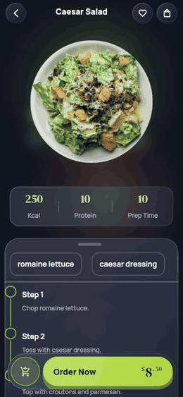
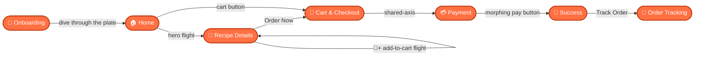

<div align="center">



<br/>

<a href="#-highlights">
  
</a>

<br/><br/>

[](https://flutter.dev)
[](https://dart.dev)
[](https://riverpod.dev)
[](LICENSE)

[](https://github.com/HammasT1/food_animations_flutter/actions/workflows/release.yml)
[](https://github.com/HammasT1/food_animations_flutter/releases/latest)
[](https://github.com/HammasT1/food_animations_flutter/stargazers)
[](https://github.com/HammasT1/food_animations_flutter/commits/main)


<br/>

<a href="https://github.com/HammasT1/food_animations_flutter/releases/latest">
  
</a>

<p>
  <a href="#-about">About</a> •
  <a href="#-feature-spotlight">Spotlight</a> •
  <a href="#-highlights">Highlights</a> •
  <a href="#-design-system">Design System</a> •
  <a href="#-animation-catalog">Animation Catalog</a> •
  <a href="#-user-flow">User Flow</a> •
  <a href="#-getting-started">Getting Started</a> •
  <a href="#-project-structure">Structure</a>
</p>

</div>


## 📖 About

<table>
  <tr>
    <td width="300" align="center" valign="top">
      
      <br/>
      <sub>Onboarding → Home → Details → Cart → Payment → Success → Tracking</sub>
    </td>
    <td valign="top">

**Food Animation** is a Flutter recipe and food-ordering app built to show what
a polished, motion-first UI can feel like.

Every screen has a signature animation, built with
[`flutter_animate`](https://pub.dev/packages/flutter_animate) and hand-rolled
`CustomPainter`s. **No heavyweight animation packages, no Lottie.**

#### At a glance

- 🎬 **7 screens**, each with its own signature motion
- 🧊 **Frosted-glass UI** over slowly drifting ambient light
- 🎨 **Every dish tints its own screens**: colours extracted from the photo at runtime
- 🛍️ **Add-to-cart flight** into a live, multi-item cart
- 🛵 **Live order tracking** on a hand-drawn, animated city map
- ✒️ **Editorial typography**: DM Serif Display + Manrope, bundled
- 🧩 **13 reusable animation primitives** in `lib/src/core/widget`
- 📳 **Haptic feedback** on key interactions
- 📦 **Automated APK releases** through GitHub Actions

    </td>
  </tr>
</table>


## 🌟 Feature Spotlight

<table>
  <tr>
    <td align="center" width="33%">
      
    </td>
    <td align="center" width="33%">
      
    </td>
    <td align="center" width="33%">
      
    </td>
  </tr>
  <tr>
    <td valign="top">
      <b>🧊 Glass &amp; dish colours</b><br/>
      <sub>Frosted cards over drifting light. Each dish's colour is pulled from its photo and tints the glow, steam, buttons, prices and confetti. Selected chips get a rotating gradient ring.</sub>
    </td>
    <td valign="top">
      <b>🛍️ Add-to-cart flight</b><br/>
      <sub>The dish lifts off the plate and arcs into the cart, spinning and shrinking with a motion trail. On landing the bag bumps, an impact ring bursts and the badge rolls up like an odometer.</sub>
    </td>
    <td valign="top">
      <b>🛵 Live order tracking</b><br/>
      <sub>A painted city map where the route lights up behind the rider, a countdown with a progress ring, and a timeline that fills stage by stage before a confetti finale.</sub>
    </td>
  </tr>
</table>


## ✨ Highlights

<table>
  <tr>
    <td width="170"><b>🚀 Onboarding</b></td>
    <td>The dish pops in with an elastic spin, garnish flies in and sways forever, black pepper shakes, and a word-by-word serif headline (with an <i>italic</i> accent) plays above a glowing, breathing call-to-action. Tapping it dives <i>through</i> the plate into the app.</td>
  </tr>
  <tr>
    <td><b>🏠 Home</b></td>
    <td>Frosted-glass recipe cards fall onto the table one by one in real perspective (<code>rotateX</code>), de-blurring as they land, each with a soft glow in its dish's colour. Category chips are selectable, and the active one wears a rotating gradient ring. A cart button with a live badge sits beside the avatar.</td>
  </tr>
  <tr>
    <td><b>🍳 Recipe Details</b></td>
    <td>The hero image flies in from the card into a slow rotisserie hover. The whole screen takes on the dish's colour: background light, plate glow, steam, nutrition numbers and the <b>Order Now</b> button, which gets a light sweep every few seconds. Tap <b>🛒+</b> to throw the dish into the cart.</td>
  </tr>
  <tr>
    <td><b>🧾 Cart &amp; Checkout</b></td>
    <td>A real multi-item cart: one glass card per dish with its own colour, stepper and line total. Bill totals <b>roll</b> like an odometer; stepping a dish down to zero removes it, and an empty cart shows a friendly empty state.</td>
  </tr>
  <tr>
    <td><b>💳 Payment</b></td>
    <td>A glossy card <b>flips on its Y-axis</b> to match the selected method (Visa / Apple Pay / PayPal / Cash). Method cards flip up in 3D as they stagger in, and the selected one is circled by a glowing, rotating gradient ring.</td>
  </tr>
  <tr>
    <td><b>🎉 Success</b></td>
    <td>The <b>morphing pay button</b> collapses into a coin, spins a loader, then balloons out to fill the screen and hands off to a self-drawing checkmark and a confetti burst in the dish's colours. The cart empties automatically.</td>
  </tr>
  <tr>
    <td><b>🛵 Order Tracking</b> <sup>new</sup></td>
    <td>A hand-painted city map (streets, park, river) where the route glows in behind a bobbing rider and a live distance pill. Steam rises from the kitchen while it cooks, the home pin pulses, then flips to a ✓. A serif countdown, progress ring and stage timeline all update together, and the whole delivery plays out in ~26 seconds.</td>
  </tr>
</table>


## 🎨 Design System

| Layer | What it does | Source |
| --- | --- | --- |
| 🧊 **Glass** | Backdrop blur, translucent tint, diagonal sheen and a hairline border that catches light on its top-left edge | [`glass_container.dart`](lib/src/core/widget/glass_container.dart) |
| 🌌 **Ambient light** | Three soft orbs drifting behind every screen, so the glass has something to refract. The lead orb takes the dish's colour | [`ambient_background.dart`](lib/src/core/widget/ambient_background.dart) |
| 🎨 **Dish colours** | Decodes each dish photo, box-averages it, ignores plates and backgrounds, buckets vivid pixels by hue and normalises the winner into a bright accent. Cached per image with Riverpod | [`dish_accent.dart`](lib/src/core/theme/dish_accent.dart) |
| ✒️ **Typography** | **DM Serif Display** for headlines, dish names and prices; **Manrope** for UI. Prices are set editorially as <sup>$</sup>12<sup>.49</sup> with tabular digits, so rolling numbers never jitter | [`app_theme.dart`](lib/src/core/theme/app_theme.dart) · [`assets/fonts`](assets/fonts) |


## 🎞️ Animation Catalog

The reusable building blocks behind the motion, and where to find them.

| Effect | Technique | Source |
| --- | --- | --- |
| 🛍️ Fly-to-target | Quadratic-Bézier arc with spin, shrink, pop and a fading motion trail in an `Overlay` | [`fly_to_target.dart`](lib/src/core/widget/fly_to_target.dart) |
| 🔔 Cart badge bump | Squash-and-stretch, wobble, impact ring and an odometer-style digit roll | [`cart_button.dart`](lib/src/checkout/presentation/widgets/cart_button.dart) |
| 🗺️ Delivery map | Painted streets, park and river; `PathMetric`-driven route reveal and rider position | [`delivery_map.dart`](lib/src/tracking/presentation/widgets/delivery_map.dart) |
| 🧭 Stage timeline | Pulsing active node, filling connectors, checks that spring in | [`stage_timeline.dart`](lib/src/tracking/presentation/widgets/stage_timeline.dart) |
| 💫 Rotating gradient ring | Sweep-gradient stroke plus a soft bloom, fading in and out with selection | [`animated_gradient_border.dart`](lib/src/core/widget/animated_gradient_border.dart) |
| ✨ Shine sweep | A diagonal band of light that glides across primary buttons every few seconds | [`shine_sweep.dart`](lib/src/core/widget/shine_sweep.dart) |
| ✅ Self-drawing checkmark | Ring sweep, overshooting tick and halo pulse (`CustomPainter`) | [`animated_checkmark.dart`](lib/src/core/widget/animated_checkmark.dart) |
| 🎊 Confetti burst | Randomised velocity, gravity, spin and flutter (`CustomPainter`) | [`confetti_overlay.dart`](lib/src/core/widget/confetti_overlay.dart) |
| ♨️ Rising steam | Blurred wisps on one repeating controller | [`rising_particles.dart`](lib/src/core/widget/rising_particles.dart) |
| 💰 Morphing pay button | Pill → coin → loader → full-screen bloom | [`morphing_pay_button.dart`](lib/src/core/widget/morphing_pay_button.dart) |
| 🔢 Odometer prices | Tweened currency with a raised symbol and cents | [`animated_price.dart`](lib/src/core/widget/animated_price.dart) |
| 📈 Count-up stats | Tweened numeric counters with tabular digits | [`animated_count.dart`](lib/src/core/widget/animated_count.dart) |
| 🌟 Breathing glow | Pulsing radial backdrop | [`glow_backdrop.dart`](lib/src/core/widget/glow_backdrop.dart) |
| ✂️ Perforated receipt edge | Dashed-line painter | [`dashed_divider.dart`](lib/src/core/widget/dashed_divider.dart) |
| 🧭 Route transitions | Slide-up and shared-axis `PageRouteBuilder`s | [`page_transition.dart`](lib/src/core/animation/page_transition.dart) |


## 🧭 User Flow




## 🧱 Tech Stack

<div align="center">


</div>

<br/>

| Area | Tools |
| --- | --- |
| **Framework** | Flutter (Material 3, Impeller renderer) |
| **State management** | [`flutter_riverpod`](https://pub.dev/packages/flutter_riverpod) (recipes, cart, dish colours) |
| **Animation** | [`flutter_animate`](https://pub.dev/packages/flutter_animate) + custom `CustomPainter`s |
| **Models** | `freezed` + `json_serializable` |
| **Theming** | [`flex_color_scheme`](https://pub.dev/packages/flex_color_scheme), bundled DM Serif Display + Manrope (SIL OFL) |
| **UI** | [`sliding_up_panel`](https://pub.dev/packages/sliding_up_panel) for the recipe-steps sheet |
| **Tooling** | `build_runner`, `flutter_lints`, `riverpod_lint`, `device_preview` |
| **CI/CD** | GitHub Actions: builds and publishes a release APK on every `v*` tag |


## 🚀 Getting Started

### Prerequisites

- Flutter SDK **3.x** (Dart 3). Run `flutter doctor` and resolve any issues.
- An Android emulator, iOS simulator, desktop target or a physical device.

### Run

```bash
# 1. Clone
git clone https://github.com/HammasT1/food_animations_flutter.git
cd food_animations_flutter

# 2. Install dependencies
flutter pub get

# 3. (Optional) regenerate model code
dart run build_runner build --delete-conflicting-outputs

# 4. Launch
flutter run
```

> [!TIP]
> Just want to try it? Grab the latest APK from the
> [**Releases**](https://github.com/HammasT1/food_animations_flutter/releases/latest) page.
> To see everything: add a dish with **🛒+**, check out, pay, then tap **Track Order**.

<details>
<summary><b>📦 Cutting a release</b></summary>

<br/>

The [`Release APK`](.github/workflows/release.yml) workflow builds a release APK
and attaches it to a GitHub Release. Trigger it either way:

```bash
# Option 1: push a tag
git tag v1.0.0 && git push origin v1.0.0

# Option 2: Actions ▸ "Release APK" ▸ Run workflow ▸ version = 1.0.0
```

</details>

<details>
<summary><b>🪟 Windows build note</b></summary>

<br/>

If the Android build fails with a Kotlin
`"this and base files have different roots"` error, keep the project and the
Dart pub cache on the **same drive**. The provided `android/gradle.properties`
flag (`kotlin.incremental=false`) also works around it.

</details>


## 🗂️ Project Structure

```text
assets/
├─ fonts/                        # DM Serif Display + Manrope (with OFL licences)
├─ images/                       # dish photography
└─ readme/                       # banner, GIFs and dividers for this README
lib/
├─ main.dart                     # app entry + onGenerateAppRoute (routes & transitions)
└─ src/
   ├─ core/
   │  ├─ animation/              # shared route transitions
   │  ├─ theme/                  # colours, type scale, dish_accent (colour extraction)
   │  └─ widget/                 # reusable animation primitives
   │     ├─ glass_container.dart / ambient_background.dart
   │     ├─ fly_to_target.dart / animated_gradient_border.dart / shine_sweep.dart
   │     ├─ animated_checkmark.dart / confetti_overlay.dart / rising_particles.dart
   │     ├─ morphing_pay_button.dart
   │     ├─ animated_price.dart / animated_count.dart
   │     └─ glow_backdrop.dart / dashed_divider.dart
   ├─ onboarding/                # animated onboarding screen
   ├─ recipes/                   # home list + recipe details (data / domain / presentation)
   ├─ checkout/                  # cart state, cart button, checkout → payment → success
   └─ tracking/                  # live order tracking: map, ETA ring, stage timeline
```


## 🤝 Contributing

Issues and pull requests are welcome. For larger changes, please open an issue
first to discuss what you would like to change.

1. Fork the repo
2. Create a branch: `git checkout -b feature/my-feature`
3. Commit your changes and push the branch
4. Open a pull request

## 📄 License

Released under the [MIT License](LICENSE). The bundled fonts are licensed under
the [SIL Open Font License](assets/fonts).

<div align="center">

<br/>

<sub>Recipe imagery is used for demonstration purposes only.</sub>

<br/><br/>

<a href="https://github.com/HammasT1/food_animations_flutter/stargazers">
  
</a>


</div>
