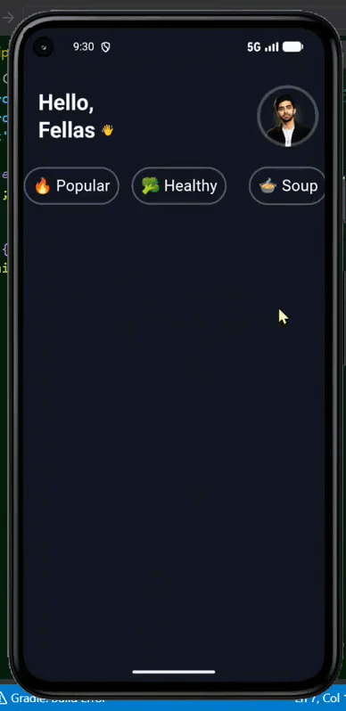

<div align="center">


<a href="https://github.com/HammasT1/food_animations_flutter">
  
</a>

<br/>

[](https://flutter.dev)
[](https://dart.dev)
[](https://riverpod.dev)
[](LICENSE)


<p>
  <a href="#-highlights">Highlights</a> •
  <a href="#-app-preview">App Preview</a> •
  <a href="#-tech-stack">Tech Stack</a> •
  <a href="#-getting-started">Getting Started</a> •
  <a href="#-project-structure">Structure</a>
</p>

</div>

---

## 📖 About

**Food Animation** is a Flutter recipe and food-ordering app built to show what
a polished, motion-first UI can feel like. Every screen has a signature
animation, all built with [`flutter_animate`](https://pub.dev/packages/flutter_animate)
and hand-rolled `CustomPainter`s. No heavyweight animation packages, no Lottie.

---

## ✨ Highlights

<table>
  <tr>
    <td width="170"><b>🚀 Onboarding</b></td>
    <td>The dish pops in with an elastic spin, garnish flies in and sways forever, black pepper shakes, and a word-by-word kinetic headline plays above a glowing, breathing call-to-action. Tapping it dives <i>through</i> the plate into the app.</td>
  </tr>
  <tr>
    <td><b>🏠 Home</b></td>
    <td>Recipe cards fall onto the table one by one in real perspective (<code>rotateX</code>), de-blurring as they land. Avatar with a pulsing halo, spring-loaded category chips, drifting steam over the hero dish.</td>
  </tr>
  <tr>
    <td><b>🍳 Recipe Details</b></td>
    <td>The hero image flies in from the card and settles into a slow rotisserie hover. The stat row <b>counts up</b> from zero, and timeline dots pop in with an elastic bounce while the connector line draws itself downward.</td>
  </tr>
  <tr>
    <td><b>🧾 Checkout</b></td>
    <td>Bill totals <b>roll</b> like an odometer when the quantity changes, with a springy stepper, haptics and a perforated dashed receipt edge.</td>
  </tr>
  <tr>
    <td><b>💳 Payment</b></td>
    <td>A glossy card <b>flips on its Y-axis</b> to match the selected method (Visa / Apple Pay / PayPal / Cash), each with its own gradient. Method cards flip up in 3D as they stagger in.</td>
  </tr>
  <tr>
    <td><b>🎉 Success</b></td>
    <td>The <b>morphing pay button</b> collapses into a coin, spins a loader, then balloons out to fill the screen and hands off to a success screen with a self-drawing checkmark and a confetti burst.</td>
  </tr>
</table>

---

## 📸 App Preview

<div align="center">



<sub>Onboarding → Home → Recipe Details → Checkout → Payment → Success</sub>

</div>

---: | :---: | :---: |
|  |  |  |

| Checkout | Payment | Success |
| :---: | :---: | :---: |
|  |  |  |

</div>
-->

---

## 🧱 Tech Stack

| Area | Tools |
| --- | --- |
| **Framework** | Flutter (Material 3, Impeller renderer) |
| **State management** | [`flutter_riverpod`](https://pub.dev/packages/flutter_riverpod) |
| **Animation** | [`flutter_animate`](https://pub.dev/packages/flutter_animate) + custom `CustomPainter`s |
| **Models** | `freezed` + `json_serializable` |
| **Theming** | [`flex_color_scheme`](https://pub.dev/packages/flex_color_scheme) |
| **UI** | [`sliding_up_panel`](https://pub.dev/packages/sliding_up_panel) for the recipe-steps sheet |
| **Tooling** | `build_runner`, `flutter_lints`, `riverpod_lint`, `device_preview` |

Custom painters power the checkmark, confetti, steam and dashed rules.

---

## 🚀 Getting Started

### Prerequisites

- Flutter SDK **3.x** (Dart 3). Run `flutter doctor` and resolve any issues.
- An Android emulator, iOS simulator, desktop target or a physical device.

### Run

```bash
# 1. Clone
git clone https://github.com/HammasT1/food_animations_flutter.git
cd food_animations_flutter

# 2. Install dependencies
flutter pub get

# 3. (Optional) regenerate model code
dart run build_runner build --delete-conflicting-outputs

# 4. Launch
flutter run
```

<details>
<summary><b>🪟 Windows build note</b></summary>

If the Android build fails with a Kotlin
`"this and base files have different roots"` error, keep the project and the
Dart pub cache on the **same drive**. The provided `android/gradle.properties`
flag (`kotlin.incremental=false`) also works around it.

</details>

---

## 🗂️ Project Structure

```text
lib/
├─ main.dart                     # app entry, routes & page transitions
└─ src/
   ├─ core/
   │  ├─ animation/              # shared route transitions
   │  ├─ theme/                  # colors + Material 3 theme
   │  └─ widget/                 # reusable animation primitives
   │     ├─ animated_checkmark.dart
   │     ├─ confetti_overlay.dart
   │     ├─ rising_particles.dart
   │     ├─ morphing_pay_button.dart
   │     ├─ animated_price.dart / animated_count.dart
   │     └─ glow_backdrop.dart / dashed_divider.dart
   ├─ onboarding/                # animated onboarding screen
   ├─ recipes/                   # home list + recipe details (data / domain / presentation)
   └─ checkout/                  # checkout → payment method → payment success
```

---

## 🤝 Contributing

Issues and pull requests are welcome. For larger changes, please open an issue
first to discuss what you would like to change.

1. Fork the repo
2. Create a branch: `git checkout -b feature/my-feature`
3. Commit your changes and push the branch
4. Open a pull request

---

## 📄 License

Released under the [MIT License](LICENSE).

<div align="center">

<sub>Recipe imagery is used for demonstration purposes only.</sub>

<br/>

⭐ If you like this project, consider giving it a star!


</div>
