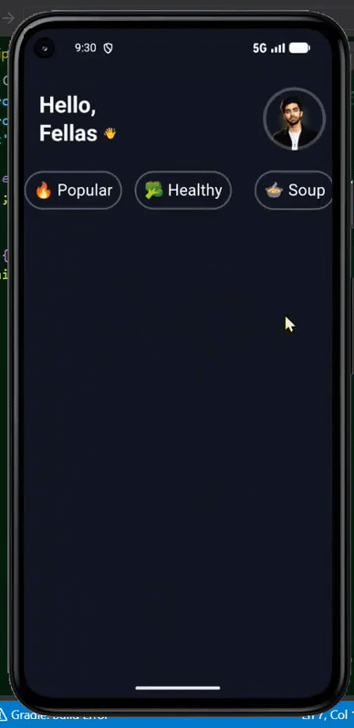

<div align="center">


<a href="#-highlights">
  
</a>

<br/><br/>

[](https://flutter.dev)
[](https://dart.dev)
[](https://riverpod.dev)
[](LICENSE)

[](https://github.com/HammasT1/food_animations_flutter/actions/workflows/release.yml)
[](https://github.com/HammasT1/food_animations_flutter/releases/latest)
[](https://github.com/HammasT1/food_animations_flutter/stargazers)
[](https://github.com/HammasT1/food_animations_flutter/commits/main)


<br/>

<a href="https://github.com/HammasT1/food_animations_flutter/releases/latest">
  
</a>

<p>
  <a href="#-about">About</a> •
  <a href="#-highlights">Highlights</a> •
  <a href="#-animation-catalog">Animation Catalog</a> •
  <a href="#-user-flow">User Flow</a> •
  <a href="#-tech-stack">Tech Stack</a> •
  <a href="#-getting-started">Getting Started</a> •
  <a href="#-project-structure">Structure</a>
</p>

</div>


## 📖 About

<table>
  <tr>
    <td width="320" align="center" valign="top">
      
      <br/>
      <sub>Onboarding → Home → Details → Checkout → Payment → Success</sub>
    </td>
    <td valign="top">

**Food Animation** is a Flutter recipe and food-ordering app built to show what
a polished, motion-first UI can feel like.

Every screen has a signature animation, built with
[`flutter_animate`](https://pub.dev/packages/flutter_animate) and hand-rolled
`CustomPainter`s. **No heavyweight animation packages, no Lottie.**

#### At a glance

- 🎬 **6 screens**, each with its own signature motion
- 🧩 **9 reusable animation primitives** in `lib/src/core/widget`
- 🎨 **Custom painters** for checkmark, confetti, steam & dashed rules
- 📳 **Haptic feedback** on key interactions
- 🌗 **Material 3** theming via `flex_color_scheme`
- 📦 **Automated APK releases** through GitHub Actions

    </td>
  </tr>
</table>


## ✨ Highlights

<table>
  <tr>
    <td width="170"><b>🚀 Onboarding</b></td>
    <td>The dish pops in with an elastic spin, garnish flies in and sways forever, black pepper shakes, and a word-by-word kinetic headline plays above a glowing, breathing call-to-action. Tapping it dives <i>through</i> the plate into the app.</td>
  </tr>
  <tr>
    <td><b>🏠 Home</b></td>
    <td>Recipe cards fall onto the table one by one in real perspective (<code>rotateX</code>), de-blurring as they land. Avatar with a pulsing halo, spring-loaded category chips, drifting steam over the hero dish.</td>
  </tr>
  <tr>
    <td><b>🍳 Recipe Details</b></td>
    <td>The hero image flies in from the card and settles into a slow rotisserie hover. The stat row <b>counts up</b> from zero, and timeline dots pop in with an elastic bounce while the connector line draws itself downward.</td>
  </tr>
  <tr>
    <td><b>🧾 Checkout</b></td>
    <td>Bill totals <b>roll</b> like an odometer when the quantity changes, with a springy stepper, haptics and a perforated dashed receipt edge.</td>
  </tr>
  <tr>
    <td><b>💳 Payment</b></td>
    <td>A glossy card <b>flips on its Y-axis</b> to match the selected method (Visa / Apple Pay / PayPal / Cash), each with its own gradient. Method cards flip up in 3D as they stagger in.</td>
  </tr>
  <tr>
    <td><b>🎉 Success</b></td>
    <td>The <b>morphing pay button</b> collapses into a coin, spins a loader, then balloons out to fill the screen and hands off to a success screen with a self-drawing checkmark and a confetti burst.</td>
  </tr>
</table>


## 🎞️ Animation Catalog

The reusable building blocks behind the motion, and where to find them.

| Effect | Technique | Source |
| --- | --- | --- |
| ✅ Self-drawing checkmark | Ring sweep, overshooting tick & halo pulse (`CustomPainter`) | [`animated_checkmark.dart`](lib/src/core/widget/animated_checkmark.dart) |
| 🎊 Confetti burst | Randomised velocity, gravity, spin & flutter (`CustomPainter`) | [`confetti_overlay.dart`](lib/src/core/widget/confetti_overlay.dart) |
| ♨️ Rising steam | Blurred wisps on one repeating controller | [`rising_particles.dart`](lib/src/core/widget/rising_particles.dart) |
| 💰 Morphing pay button | Pill → coin → loader → full-screen bloom | [`morphing_pay_button.dart`](lib/src/core/widget/morphing_pay_button.dart) |
| 🔢 Odometer prices | Tweened currency value that rolls between amounts | [`animated_price.dart`](lib/src/core/widget/animated_price.dart) |
| 📈 Count-up stats | Tweened numeric counters | [`animated_count.dart`](lib/src/core/widget/animated_count.dart) |
| 🌟 Breathing glow | Pulsing radial backdrop | [`glow_backdrop.dart`](lib/src/core/widget/glow_backdrop.dart) |
| ✂️ Perforated receipt edge | Dashed-line painter | [`dashed_divider.dart`](lib/src/core/widget/dashed_divider.dart) |
| 🧭 Route transitions | Slide-up & shared-axis `PageRouteBuilder`s | [`page_transition.dart`](lib/src/core/animation/page_transition.dart) |


## 🧭 User Flow


## 🧱 Tech Stack

<div align="center">


</div>

<br/>

| Area | Tools |
| --- | --- |
| **Framework** | Flutter (Material 3, Impeller renderer) |
| **State management** | [`flutter_riverpod`](https://pub.dev/packages/flutter_riverpod) |
| **Animation** | [`flutter_animate`](https://pub.dev/packages/flutter_animate) + custom `CustomPainter`s |
| **Models** | `freezed` + `json_serializable` |
| **Theming** | [`flex_color_scheme`](https://pub.dev/packages/flex_color_scheme) |
| **UI** | [`sliding_up_panel`](https://pub.dev/packages/sliding_up_panel) for the recipe-steps sheet |
| **Tooling** | `build_runner`, `flutter_lints`, `riverpod_lint`, `device_preview` |
| **CI/CD** | GitHub Actions: builds and publishes a release APK on every `v*` tag |


## 🚀 Getting Started

### Prerequisites

- Flutter SDK **3.x** (Dart 3). Run `flutter doctor` and resolve any issues.
- An Android emulator, iOS simulator, desktop target or a physical device.

### Run

```bash
# 1. Clone
git clone https://github.com/HammasT1/food_animations_flutter.git
cd food_animations_flutter

# 2. Install dependencies
flutter pub get

# 3. (Optional) regenerate model code
dart run build_runner build --delete-conflicting-outputs

# 4. Launch
flutter run
```

> [!TIP]
> Just want to try it? Grab the latest APK from the
> [**Releases**](https://github.com/HammasT1/food_animations_flutter/releases/latest) page.

<details>
<summary><b>📦 Cutting a release</b></summary>

<br/>

The [`Release APK`](.github/workflows/release.yml) workflow builds a release APK
and attaches it to a GitHub Release. Trigger it either way:

```bash
# Option 1: push a tag
git tag v1.0.0 && git push origin v1.0.0

# Option 2: Actions ▸ "Release APK" ▸ Run workflow ▸ version = 1.0.0
```

</details>

<details>
<summary><b>🪟 Windows build note</b></summary>

<br/>

If the Android build fails with a Kotlin
`"this and base files have different roots"` error, keep the project and the
Dart pub cache on the **same drive**. The provided `android/gradle.properties`
flag (`kotlin.incremental=false`) also works around it.

</details>


## 🗂️ Project Structure

```text
lib/
├─ main.dart                     # app entry, routes & page transitions
└─ src/
   ├─ core/
   │  ├─ animation/              # shared route transitions
   │  ├─ theme/                  # colors + Material 3 theme
   │  └─ widget/                 # reusable animation primitives
   │     ├─ animated_checkmark.dart
   │     ├─ confetti_overlay.dart
   │     ├─ rising_particles.dart
   │     ├─ morphing_pay_button.dart
   │     ├─ animated_price.dart / animated_count.dart
   │     └─ glow_backdrop.dart / dashed_divider.dart
   ├─ onboarding/                # animated onboarding screen
   ├─ recipes/                   # home list + recipe details (data / domain / presentation)
   └─ checkout/                  # checkout → payment method → payment success
```


## 🤝 Contributing

Issues and pull requests are welcome. For larger changes, please open an issue
first to discuss what you would like to change.

1. Fork the repo
2. Create a branch: `git checkout -b feature/my-feature`
3. Commit your changes and push the branch
4. Open a pull request

## 📄 License

Released under the [MIT License](LICENSE).

<div align="center">

<br/>

<sub>Recipe imagery is used for demonstration purposes only.</sub>

<br/><br/>

<a href="https://github.com/HammasT1/food_animations_flutter/stargazers">
  
</a>


</div>
